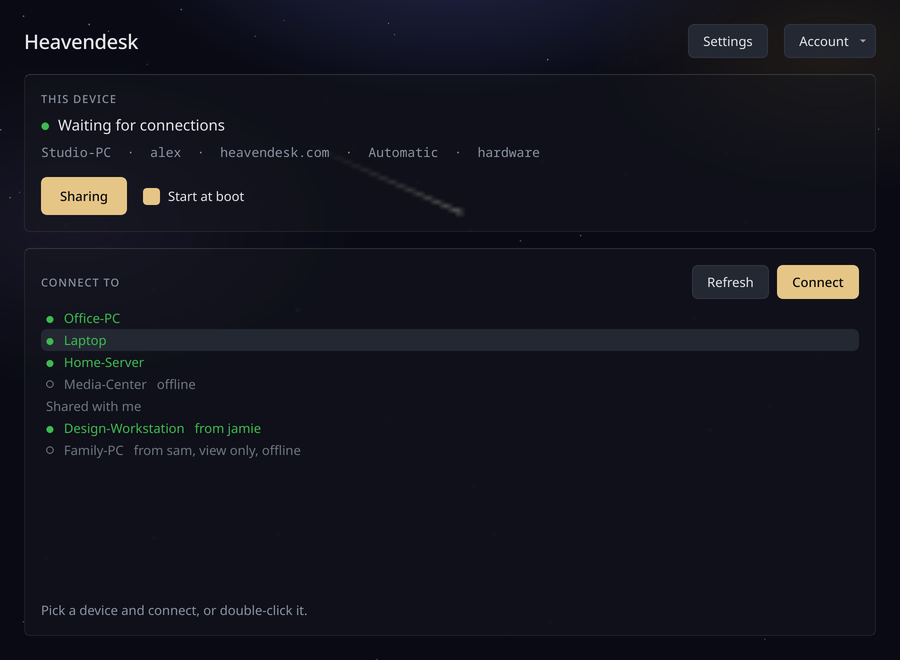
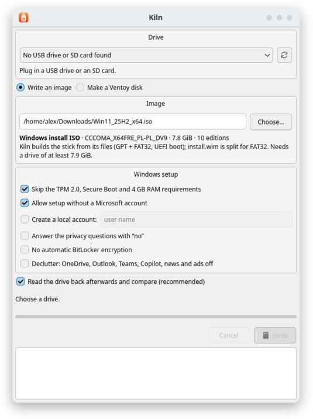
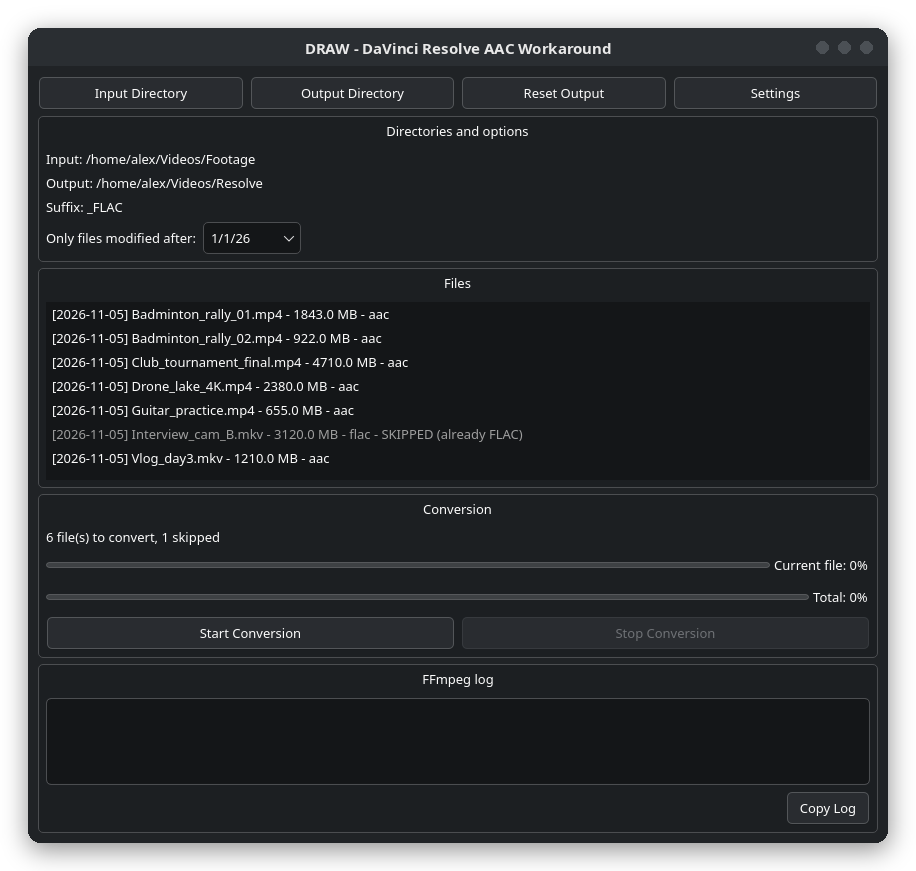

# Hi, I'm TryCoffee

**Linux and systems tinkerer.** I'd rather understand a tool and rebuild it than accept its defaults. 
I write desktop software that lives close to the machine: screen capture on the GPU, raw disk writes, video pipelines.

---

## Projects

<table>
<tr>
<td width="50%" valign="top">

###  Heavendesk

Low-latency remote desktop for **Windows and Linux**, built from scratch in C++.
The screen is captured and encoded on the graphics card, so it feels like sitting at the machine, not watching a video of it.

- Wayland, X11 and Windows hosts, every monitor as its own stream
- Reach a machine at the login screen, no open session needed
- Works on strict networks: only outgoing HTTPS on port 443
- File transfer and a remote terminal since 0.2

Closed source. Free during the beta.

</td>
<td width="50%" valign="top">

</td>
</tr>
<tr>
<td width="50%" valign="top">

</td>
<td width="50%" valign="top">

###  Kiln

USB flasher for **Linux, Windows and macOS**. Every write is read back and compared, and it only ever offers USB drives, SD cards and removable disks.

- Raw image writes (Linux ISOs, `.img`) with verification
- Windows 11 install sticks, with optional Rufus-style tweaks: skip TPM and Secure Boot checks, no Microsoft account
- Ventoy disks in one click

</td>
</tr>
<tr>
<td width="50%" valign="top">

### DRAW

**D**aVinci **R**esolve **A**AC **W**orkaround. Resolve on Linux can't import AAC audio, so DRAW batch-converts the audio of `.mp4` and `.mkv` files to lossless FLAC and copies the video untouched.

- Skips files that are already FLAC (checked with `ffprobe`)
- Real per-file progress, and Stop really stops
- PyQt6, follows your system theme

</td>
<td width="50%" valign="top">

</td>
</tr>
</table>

---

## GitHub Stats

